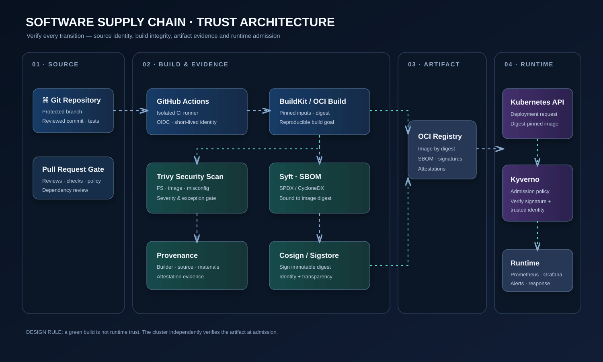

# Cloud-Native Software Supply Chain Security Platform

> A production-minded DevSecOps reference implementation establishing verifiable trust from source commit to Kubernetes runtime.

[](docs/architecture/interactive.html)

This lab demonstrates controlled builds, vulnerability scanning, SBOM generation, provenance, artifact signing and Kubernetes admission verification. A green build is not automatically a trusted deployment: the cluster independently verifies the artifact.

## Capabilities
- GitHub Actions with least-privilege permissions and OIDC short-lived identity.
- Immutable OCI image digests; do not trust mutable tags as integrity evidence.
- Trivy source/image scanning under explicit block and exception policy.
- Syft SBOM generation tied to the exact artifact digest.
- Cosign/Sigstore signatures and build provenance/attestations.
- Kubernetes admission enforcement with Kyverno verifyImages.
- Operational evidence, threat modelling, runbooks and senior interview preparation.

## Architecture
- [Interactive animated architecture](docs/architecture/interactive.html)
- [Static architecture diagram](docs/architecture/architecture.svg)
- [Architecture and trust boundaries](docs/architecture/README.md)
- [Architecture decision records](docs/architecture/decisions/)

## Run it

See the [end-to-end lab guide](docs/implementation/run-the-lab.md) for local tests, Docker Compose, Trivy/Syft, GHCR release, Cosign signing and the Kyverno lab.

```bash
python -m pip install -r requirements-dev.txt
python -m pytest -q
docker compose up --build -d
```

## Observability

The Compose stack provisions Prometheus and Grafana with an API dashboard for request rate, p95 latency, request totals and status codes. See the [monitoring configuration](monitoring/) and [lab guide](docs/implementation/run-the-lab.md).

## Learning path
1. [Threat model](docs/security/threat-model.md)
2. [Security exception register](docs/security/exception-register.md)
3. [Implementation roadmap](docs/implementation/roadmap.md)
4. [8+ years senior DevSecOps interview handbook](docs/interview/README.md)
5. [Scenario answer framework](docs/interview/scenario-answer-template.md)
6. [Senior interview project walkthrough](docs/interview/project-walkthrough.md)

## Technology map

| Capability | Tooling | Evidence |
|---|---|---|
| Source CI | GitHub Actions | Workflow run and test results |
| Workload identity | GitHub OIDC | Short-lived federated identity |
| Container build | Docker / BuildKit | Immutable digest |
| Vulnerability scanning | Trivy | Scan report and policy result |
| SBOM | Syft | SPDX / CycloneDX inventory |
| Signing | Cosign / Sigstore | Signature tied to digest and identity |
| Provenance | GitHub attestations / SLSA concepts | Build provenance |
| Admission | Kubernetes + Kyverno | Reject untrusted images |
| Observability | Prometheus / Grafana | Security and delivery signals |

## Security caveats
A signature proves that an identity signed a digest; it does not prove the image is vulnerability-free. An SBOM is an inventory, not a security certification. Provenance is only as trustworthy as its builder, source controls and verification policy. Never commit production credentials, private signing keys, customer telemetry or real secrets.

## Status
This repository is being built as a hands-on lab. Architecture and learning material are not evidence that integrations are deployed. A control is operational only after its tests and workflow runs succeed. See the roadmap for phase-by-phase acceptance criteria.
