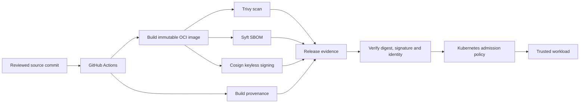

<div align="center">


### Source integrity · Artifact identity · Provenance · Runtime verification

[](https://github.com/haqueamir70-coder/cloud-native-software-supply-chain-security-platform/actions/workflows/ci.yml)
[](https://github.com/haqueamir70-coder/cloud-native-software-supply-chain-security-platform/actions/workflows/release.yml)
[](https://trivy.dev/)
[](https://docs.sigstore.dev/cosign/)

**A DevSecOps reference implementation that builds verifiable trust from source commit to container digest — using scanning, SBOMs, signing, provenance and Kubernetes admission verification.**

[Architecture](#-trust-chain-architecture) · [Run the lab](#-run-the-lab) · [Evidence](#-verified-release-evidence) · [Security model](#-what-each-control-proves)

</div>

## Why this matters

A container image can be built successfully and still be vulnerable, tampered with or produced by an untrusted workflow. A secure supply chain needs evidence about **what was built, how it was built, which identity produced it, and whether the cluster verifies the exact artifact it runs**.

## Trust-chain architecture

<p align="center">
  <a href="docs/architecture/interactive.html"></a>
</p>



A signed digest is not automatically a safe image. Runtime admission must independently verify the artifact against the expected identity and policy.

## Security capabilities

| Control | Tool / mechanism | What it provides |
|---|---|---|
| Source and dependency checks | GitHub Actions, Trivy | Findings against evaluated source/artifacts |
| Immutable artifact identity | OCI digest | Stable reference to exact image content |
| SBOM | Syft | Component inventory tied to the artifact |
| Signature | Cosign / Sigstore | Cryptographic signature and signing identity |
| Provenance | GitHub attestations / SLSA concepts | Build origin and process evidence |
| Admission | Kyverno verifyImages | Runtime verification policy |
| Observability | Prometheus / Grafana | Workload and pipeline signals |

## Run the lab

Start with the [end-to-end lab guide](docs/implementation/run-the-lab.md), which covers local tests, Docker Compose, Trivy/Syft, GHCR release, Cosign signing and the Kyverno lab.

```bash
python -m pip install -r requirements-dev.txt
python -m pytest -q
docker compose up --build -d
```

The optional [Azure AKS Terraform lab](terraform/azure/README.md) provisions billable infrastructure. Review the cost warning, quotas, identity and network prerequisites before applying.

## Verified release evidence

[Open the successful signed-image release workflow run](https://github.com/haqueamir70-coder/cloud-native-software-supply-chain-security-platform/actions/runs/41786989755).

The recorded run passed image scanning, Cosign keyless signing and identity verification, GitHub provenance generation, and SPDX SBOM upload. Always inspect the workflow logs and artifact digest rather than relying on the badge alone.

## Current implementation boundary

- Source-to-image CI/release path is implemented and has a successful workflow run covering tests, Trivy scans, Terraform validation, Docker Compose smoke tests, image signing, signature verification, provenance and SPDX SBOM upload.
- Kubernetes admission policy is configured in Audit mode.
- Positive/negative admission tests and transition to Enforce mode still require a disposable kind/AKS cluster.
- The optional AKS Terraform root is validated in CI but has not been applied because it creates billable Azure resources.

See the [implementation roadmap](docs/implementation/roadmap.md) and [exception register](docs/security/exception-register.md) for the detailed status.

## What each control proves — and does not prove

- **Scan:** reports findings for the scanned artifact and configured rules; it cannot prove absence of vulnerabilities.
- **SBOM:** inventories components; it is not a security certification.
- **Signature:** proves an identity signed a particular digest; it does not prove the image is benign.
- **Provenance:** describes build origin/process; trust depends on builder isolation and verification.
- **Admission policy:** enforces configured runtime rules only when installed and operating in the target cluster.

## Security engineering

- Use least-privilege GitHub Actions permissions and short-lived OIDC identity.
- Pin production images by digest, not mutable tags.
- Keep signing private keys and production secrets out of the repository.
- Define vulnerability thresholds and time-bound exceptions with owners.
- Verify signatures and provenance at the cluster boundary.
- Keep admission policy rollout staged: Audit, test, then Enforce with rollback.
- Do not commit customer payloads, credentials or kubeconfigs.

## Repository navigation

- [Interactive architecture preview](docs/architecture/interactive.html)
- [Static architecture diagram](docs/architecture/architecture.svg)
- [Architecture and trust boundaries](docs/architecture/README.md)
- [Architecture decision records](docs/architecture/decisions/)
- [Threat model](docs/security/threat-model.md)
- [Security exception register](docs/security/exception-register.md)
- [Run the complete lab](docs/implementation/run-the-lab.md)
- [Roadmap](docs/implementation/roadmap.md)
- [Interview handbook](docs/interview/README.md)

## Maintainer

**MD Amirul Haque** · [GitHub](https://github.com/haqueamir70-coder) · [LinkedIn](https://www.linkedin.com/in/md-amirul-haque/)

<sub>Trust the digest, verify the identity, enforce at runtime.</sub>
