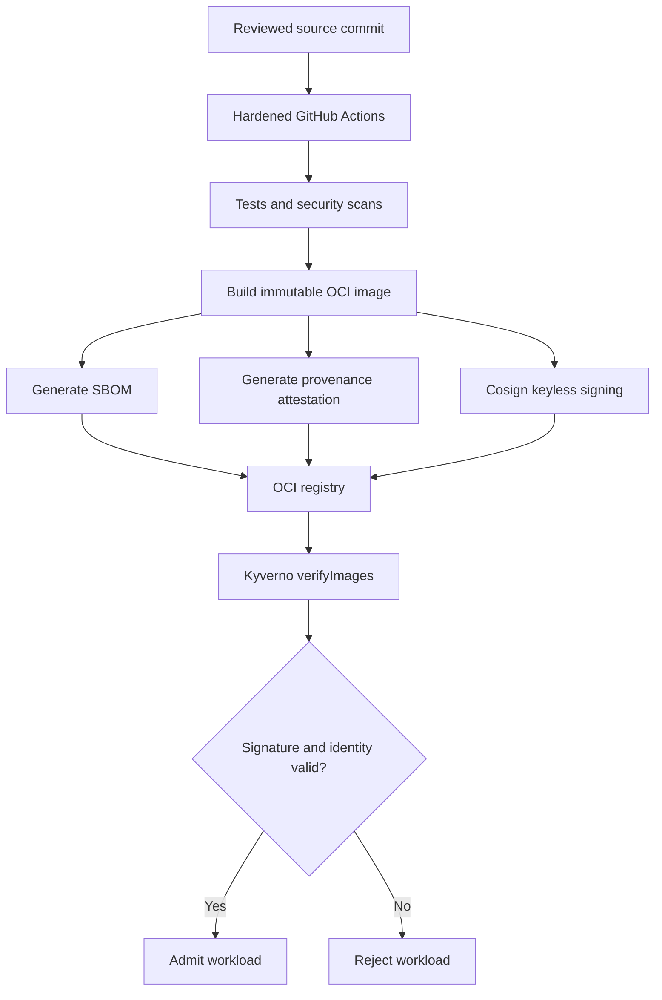

# Cloud-native software supply-chain security — Architecture & Interview Guide

End-to-end trust chain from source commit to artifact digest and Kubernetes admission. CI/release evidence exists; admission enforcement and cluster tests remain separate validation milestones.

## Architecture diagram

## Interview questions

1. 1. What is software supply-chain security and why is it important?
2. 2. What does an SBOM provide and what does it not prove?
3. 3. How do image digests differ from mutable tags?
4. 4. How does Cosign keyless signing work with OIDC identity?
5. 5. What does SLSA provenance attest to?
6. 6. How do you verify an image signature at Kubernetes admission time?
7. 7. What is the difference between Kyverno Audit and Enforce modes?
8. 8. How do you test both allowed and rejected image admission paths?
9. 9. How do you handle vulnerability exceptions and remediation SLAs?
10. 10. Why does a signed image not automatically mean a vulnerability-free image?

## Interview preparation note
For every answer, explain the architecture, trust boundary, failure mode, telemetry, cost implication and validation evidence. Distinguish implemented, CI-validated, cloud-deployed and planned capabilities.
