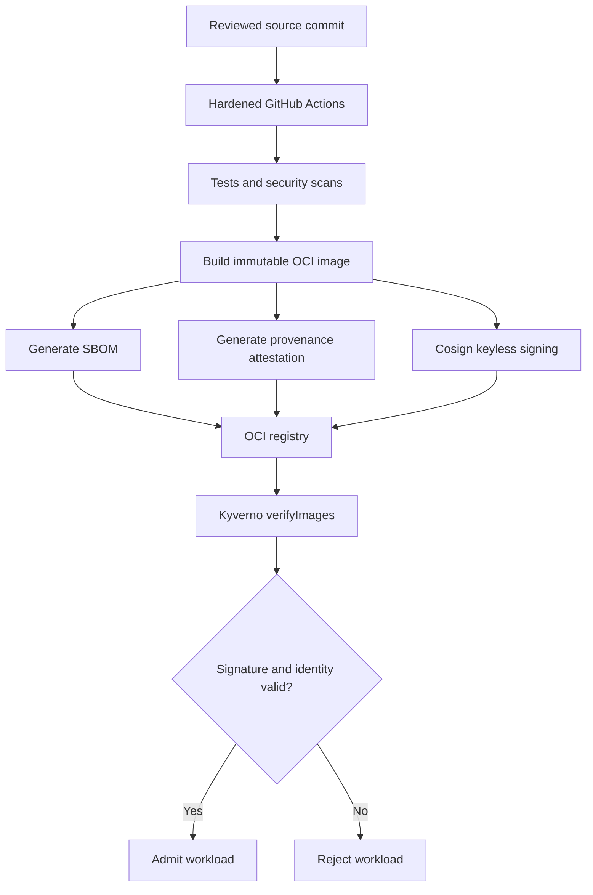

# Cloud-native software supply-chain security — Architecture & Interview Guide

End-to-end trust chain from source commit to artifact digest and Kubernetes admission. CI/release evidence exists; admission enforcement and cluster tests remain separate validation milestones.

## Architecture diagram

## Interview questions

1. 1. What is software supply-chain security and why is it important?
2. 2. What does an SBOM provide and what does it not prove?
3. 3. How do image digests differ from mutable tags?
4. 4. How does Cosign keyless signing work with OIDC identity?
5. 5. What does SLSA provenance attest to?
6. 6. How do you verify an image signature at Kubernetes admission time?
7. 7. What is the difference between Kyverno Audit and Enforce modes?
8. 8. How do you test both allowed and rejected image admission paths?
9. 9. How do you handle vulnerability exceptions and remediation SLAs?
10. 10. Why does a signed image not automatically mean a vulnerability-free image?

## Interview preparation note
For every answer, explain the architecture, trust boundary, failure mode, telemetry, cost implication and validation evidence. Distinguish implemented, CI-validated, cloud-deployed and planned capabilities.

## Interview questions — suggested answers

### 1. Answer

Supply-chain security protects source, build systems, dependencies, artifacts and deployment. Attackers can compromise any stage before runtime.

### 2. Answer

An SBOM lists components and versions to support vulnerability/license analysis. It is not a guarantee that all components are known or safe.

### 3. Answer

A tag is a mutable reference; a digest is a content-addressed immutable identifier. A digest ties scan, signature and deployment to the exact bytes.

### 4. Answer

Cosign keyless signing uses an OIDC identity and ephemeral certificate backed by Sigstore infrastructure, allowing verifiers to validate signer identity and signature transparency evidence.

### 5. Answer

SLSA provenance describes how an artifact was built, including source and builder details. Its value depends on trusted, isolated and verifiable build infrastructure.

### 6. Answer

Kyverno verifyImages can require signatures and validate identity/attestations at admission. The policy should pin trusted registries, identities and keyless issuer constraints.

### 7. Answer

Audit records violations without rejecting workloads; Enforce rejects non-compliant admission requests. Test in Audit before enforcing broadly.

### 8. Answer

Create a known-good signed image and an unsigned/tampered image, attempt both in a disposable cluster, assert the first is admitted and the second denied, and retain test logs.

### 9. Answer

Use severity-based remediation SLAs, exception owner/expiry, compensating controls and re-scan on new image digest. A waiver must not silently persist forever.

### 10. Answer

Signing proves an identity signed a particular digest; it does not prove the image has no vulnerabilities, malicious logic or insecure runtime configuration.